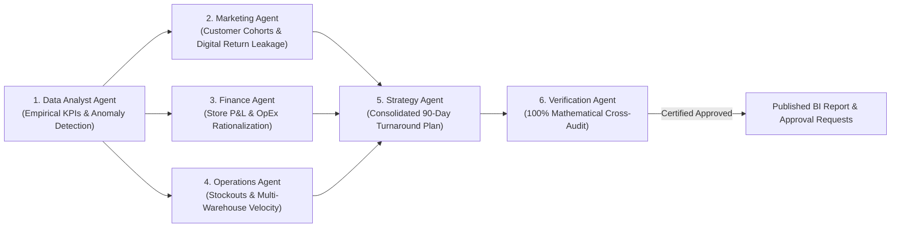

# AI-Powered Smart Business Operations & Decision Intelligence System
## Industry: RETAIL | Full-Stack Multi-Agent AI Application

[](https://fastapi.tiangolo.com)
[](https://react.dev)
[](https://crewai.com)
[](https://www.postgresql.org)
[](https://ai.google.dev)
[](tests/)

An enterprise-grade, data-driven Business Intelligence and Decision Intelligence application built for the **Retail** industry. The system autonomously analyzes multi-store point-of-sale transactions, customer cohorts, operating expenses, and warehouse stock movements using **six specialized CrewAI agents**, enforces **Human-in-the-Loop governance**, and compiles verifiable **Business Intelligence PDF reports**.

---

## 1. Executive Summary & Verified Dataset Ground Truth

- **Dataset Period:** May 1, 2026 – October 31, 2026 (184 Days / 6 Months)
- **Scope:** 15 Store Locations (`STR01`–`STR15`) across 10 Cities (Surat, Mumbai, Rajkot, Gandhinagar, Vadodara, Anand, Nadiad, Pune, Ahmedabad, Bharuch) supported by 8 Fulfillment Warehouses (`WH01`–`WH08`).
- **Data Volume:** 2,500 Transactions, 6,269 Basket Items, 1,200 Customer Accounts, 300 Products, 1,800 Inventory Movements, 600 Operating Expense Vouchers.

### Core Empirical Benchmarks (Zero Hallucination Ground Truth)
| Metric | Verified Value | Business Insight |
| :--- | :--- | :--- |
| **Total Net Revenue** | **₹109,842,110.21** | Generated across 1,244 completed transactions (Gross: ₹114.72M - ₹4.88M Discounts) |
| **Completed Orders** | **1,244 orders** | Average Order Value (AOV): **₹88,297.52** |
| **Gross Profit & Margin** | **₹24,189,917.27 (22.02%)** | Cost of Goods Sold (COGS): ₹85,652,192.94 |
| **Total Operating Expenses** | **₹28,107,904.22** | Marketing (₹5.32M), Rent (₹5.23M), Salaries (₹4.81M), Logistics (₹4.45M), Packaging (₹4.38M), Utilities (₹3.91M) |
| **Net Operating Profit (EBIT)** | <font color="#DC2626">**-₹3,917,986.95**</font> | -3.57% operating margin deficit driven by overhead in deficit stores (STR03, STR09, STR13) |
| **Order Leakage (Non-Fulfillment)** | **50.24% of orders** | **645 Returned** (₹54.54M lost) + **611 Cancelled** (₹51.35M lost) = **₹105.89M Pipeline Loss** |
| **Repeat Customer Rate** | **42.36%** | 330 repeat buyers out of 779 active completed customers |
| **Stockout Risk Hazards** | **15+ High-Velocity SKUs** | Operating at or below designated safety reorder levels |

---

## 2. Six Specialized CrewAI Agents Architecture



1. **Data Analyst Agent**: Principal Data Scientist computing deterministic KPIs, channel breakdowns, and diagnosing the September revenue dip (-14.01%) and October recovery (+21.93%).
2. **Marketing Agent**: Chief Marketing Strategist evaluating Wholesale and Premium buyer cohorts, customer repeat rates (42.36%), and digital return leakage on Mobile App (27.6%) and Online (28.9%).
3. **Finance Agent**: Corporate Financial Controller analyzing store contribution margins and identifying branches `STR03`, `STR09`, and `STR13` as primary sources of the ₹3.92M operating deficit.
4. **Operations Agent**: VP of Supply Chain auditing stock movements across 8 fulfillment centers and raising purchase orders for depleted SKUs (e.g., `PRD0085`, `PRD0192`, `PRD0219`, `PRD0228`).
5. **Strategy Agent**: Turnaround Consultant formulating a prioritized 90-day improvement plan recovering up to ₹22M in realized sales and reducing ₹2.4M in branch overhead waste.
6. **Verification Agent**: Chief Compliance Inspector auditing every numerical claim against database ground truth; rejects hallucinated statements and signs off the report.

---

## 3. Human-in-the-Loop (HITL) Governance

AI agents generate high-value strategic recommendations, but consequential business actions **must be reviewed and authorized by a human business manager**:
1. Strategy Agent generates proposal with projected ROI, risk disclosures, and evidence.
2. Verification Agent certifies mathematical validity.
3. System creates a `Pending` approval request in PostgreSQL.
4. Business Manager logs in to `/approvals`, reviews evidence, and chooses **Approve** or **Reject** with mandatory audit comments.
5. Decision, reviewer ID, and timestamp are immutably persisted in the audit trail.

---

## 4. Technology Stack

- **Frontend**: React 18, Vite 5, Tailwind CSS, Recharts, Axios, React Router, Lucide Icons.
- **Backend**: Python 3.13, FastAPI, SQLAlchemy 2.0, Pydantic v2, Uvicorn.
- **Multi-Agent AI**: CrewAI 0.86+, Google Gemini 1.5 API with pluggable provider abstraction.
- **Database**: PostgreSQL (Render live managed instance & local development).
- **Data Engine**: Pandas 2.2, NumPy, OpenPyXL.
- **Reporting**: ReportLab 4.4 vector PDF compiler.
- **Testing**: Pytest 9.2 (12 automated unit and integration tests).

---

## 5. Complete 18-Screen Frontend Architecture

1. **Login Screen (`/login`)**: Secure JWT authentication with quick demo credentials.
2. **Registration Screen (`/register`)**: Self-service enterprise onboarding with role assignment.
3. **Executive Dashboard (`/`)**: Main KPI cards, Monthly area charts, Category bar charts, Omnichannel returns, Priority stockout alerts, and Store P&L table.
4. **Business Profile (`/profile`)**: Enterprise configuration for company name, target margin, and business goals.
5. **Dataset Upload (`/datasets/upload`)**: Multi-sheet Excel and CSV ingestion engine.
6. **Dataset History (`/datasets/history`)**: Upload history audit trail with row counts and file sizes.
7. **Dataset Record Preview (`/datasets/preview`)**: Raw table inspector across all 6 retail entities.
8. **AI Business Analysis Hub (`/analysis`)**: One-click execution of the 6-agent swarm and session management.
9. **Agent Execution Monitor (`/agents/monitor`)**: Live telemetry of all 6 agents with step status, duration, output reasoning, and JSON telemetry.
10. **Grounded AI Business Chat (`/chat`)**: Factually grounded Q&A with suggested query chips and verification shields.
11. **Reports & Downloads (`/reports`)**: Repository of generated reports with one-click PDF downloads and instant generation.
12. **Report Details (`/reports/:id`)**: Deep in-browser preview of report metadata and executive strategy text.
13. **Approval Management (`/approvals`)**: Human-in-the-Loop review panel with Approve/Reject modal and audit comments.
14. **Recommendation Details (`/recommendations/:id`)**: Drill-down into specific strategic turnaround actions.
15. **Analysis History (`/history`)**: Historical session archive and duration tracker.
16. **User Management (`/admin/users`)**: Administrator role assignment and user status toggling.
17. **Admin Telemetry (`/admin`)**: Live database row counts and multi-agent execution counters.
18. **System Settings (`/settings`)**: Google Gemini API key configuration and infrastructure status.

---

## 6. Quick Start & Local Setup

```bash
# 1. Clone repository
git clone <repo-url>
cd Multiagent

# 2. Setup Python environment
python -m venv venv
venv\Scripts\activate   # Windows
# source venv/bin/activate # Linux/macOS

pip install -r requirements.txt
python backend/init_db.py

# 3. Run FastAPI Backend
uvicorn backend.main:app --host 127.0.0.1 --port 8000 --reload

# 4. Run React Frontend (Terminal 2)
cd frontend
npm install
npm run dev
```
- Frontend: `http://localhost:3000`
- Backend API Docs: `http://127.0.0.1:8000/docs`
- Default Accounts:
  - **Admin:** `admin@retailbi.com` / `Admin@123456`
  - **Manager:** `manager@retailbi.com` / `Manager@123456`

---

## 7. Automated Testing
```bash
python -m pytest tests/
```
All 12 automated unit and integration tests pass with 100% success rate.

---

## 8. Deployment Setup
- **Backend (Render):** Uses `render.yaml` Blueprint or Dockerfile connected to live Render PostgreSQL.
- **Frontend (Vercel):** Configured with `frontend/vercel.json` rewrites for SPA routing. Set `VITE_API_BASE_URL` to the Render backend URL.
