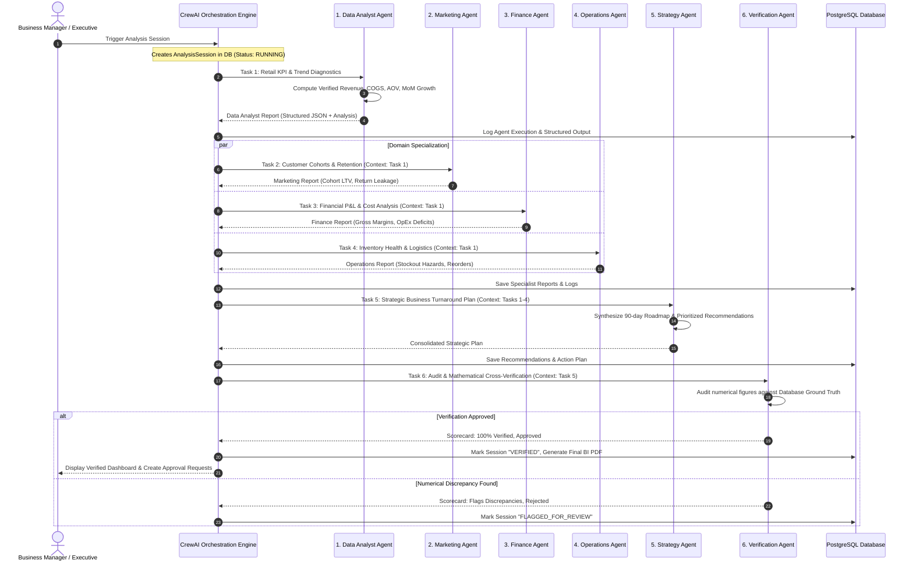

# Agent Workflow & Collaboration Pipeline

**Document Reference:** AGT-WF-2026-V1  
**Framework:** CrewAI Multi-Agent Pipeline  
**Execution Type:** Sequential with Shared Structured Context  

---

## 1. End-to-End Orchestrated Pipeline



---

## 2. Detailed Task Input-Output Contracts

### Task 1: `analyze_retail_kpis`
- **Assigned Agent:** Data Analyst Agent
- **Inputs:** Raw PostgreSQL transaction data (`May 1 – October 31, 2026`).
- **Tools:** `get_dataset_kpis_tool`, `get_monthly_sales_trend_tool`.
- **Output Contract:**
  ```json
  {
    "period": "2026-05-01 to 2026-10-31",
    "completed_transactions": 1244,
    "gross_revenue": 114717566.35,
    "discount_amount": 4875456.14,
    "net_revenue": 109842110.21,
    "aov": 88297.52,
    "total_units_sold": 9332,
    "monthly_trends": [
      {"month": "2026-05", "net_revenue": 15531889.18, "orders": 185},
      {"month": "2026-06", "net_revenue": 16477629.50, "orders": 192, "mom_growth_pct": 6.09},
      {"month": "2026-07", "net_revenue": 18441535.12, "orders": 207, "mom_growth_pct": 11.92},
      {"month": "2026-08", "net_revenue": 20419952.36, "orders": 225, "mom_growth_pct": 10.73},
      {"month": "2026-09", "net_revenue": 17559830.81, "orders": 201, "mom_growth_pct": -14.01},
      {"month": "2026-10", "net_revenue": 21411273.24, "orders": 234, "mom_growth_pct": 21.93}
    ]
  }
  ```

### Task 2: `evaluate_marketing_performance`
- **Assigned Agent:** Marketing Agent
- **Context:** Output from Task 1.
- **Tools:** `get_customer_segmentation_tool`, `get_channel_returns_tool`.
- **Output Contract:**
  - Segment performance summary (Wholesale, Premium, Regular, New).
  - Repeat purchase rate (46.14%).
  - Channel return variance: In-store (20.5% return rate) vs Online (29.1%) vs Mobile App (28.3%).
  - Targeted retention opportunities for tier-2 cities.

### Task 3: `analyze_financial_margins`
- **Assigned Agent:** Finance Agent
- **Context:** Output from Task 1.
- **Tools:** `get_financial_pl_tool`, `get_store_expenses_breakdown_tool`.
- **Output Contract:**
  - COGS: ₹85,652,192.94.
  - Gross Profit: ₹24,189,917.27 (Gross Margin: 22.02%).
  - OpEx Breakdown: ₹28,107,904.22 across 6 categories.
  - Operating Loss: -₹3,917,986.95.
  - Store-level P&L identifying deficit branches (`STR03`, `STR09`, `STR13`).

### Task 4: `audit_inventory_supply_chain`
- **Assigned Agent:** Operations Agent
- **Context:** Output from Task 1.
- **Tools:** `get_inventory_health_tool`, `get_stockout_risks_tool`.
- **Output Contract:**
  - Stockout risk alerts for SKUs below `reorder_level`.
  - Warehouse distribution efficiency across `WH01` - `WH08`.
  - Reorder recommendations.

### Task 5: `generate_strategic_turnaround_plan`
- **Assigned Agent:** Strategy Agent
- **Context:** Outputs from Tasks 1, 2, 3, 4.
- **Output Contract:**
  - Consolidated Executive Action Plan.
  - 4 Prioritized Business Recommendations with explicit rationale, expected financial impact, and risk rating.

### Task 6: `verify_and_certify_report`
- **Assigned Agent:** Verification Agent
- **Context:** Output from Task 5.
- **Tools:** `verify_metric_grounding_tool`.
- **Output Contract:**
  - Verification audit log matching numbers against database calculations.
  - Approval state (`APPROVED` / `REJECTED`).
