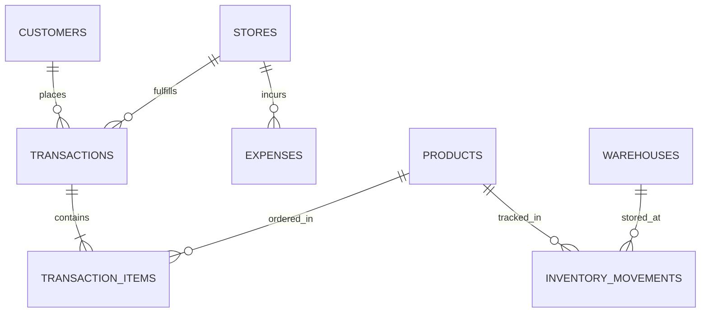

# Retail Intelligence Data Dictionary

**Dataset:** `03_Retail.xlsx`  
**Domain:** Retail Sales, Customer, Product, Inventory and Expense Intelligence  
**Period:** May 1, 2026 – October 31, 2026  

---

## 1. Entity Relationship Overview

---

## 2. Comprehensive Data Dictionary Tables

### 2.1 Table: `customers` (Source Sheet: `Customers`)
| Column Name | Data Type | Nullable | Primary / Foreign Key | Description | Example Value | Business Purpose | Related Entity |
| :--- | :--- | :---: | :---: | :--- | :--- | :--- | :--- |
| `customer_id` | VARCHAR(16) | No | **PK** | Unique customer identifier | `CUS00001` | Identifies individual retail customer account | `transactions.customer_id` |
| `customer_name` | VARCHAR(128) | No | - | Customer full legal/display name | `Aadhya Sharma` | Personalization, customer reporting | - |
| `city` | VARCHAR(64) | No | - | Customer resident city | `Gandhinagar` | Geographic segmentation & store assignment | - |
| `signup_date` | DATE | No | - | Registration/onboarding date | `2026-07-06` | Cohort analysis & tenure calculation | - |
| `customer_segment` | VARCHAR(32) | No | - | Segment classification (`Regular`, `New`, `Wholesale`, `Premium`) | `Regular` | Target marketing & loyalty tiering | - |
| `email` | VARCHAR(128) | No | - | Customer contact email | `aadhya.sharma30@example.com` | Notification channel, CRM communication | - |

### 2.2 Table: `products` (Source Sheet: `Products`)
| Column Name | Data Type | Nullable | Primary / Foreign Key | Description | Example Value | Business Purpose | Related Entity |
| :--- | :--- | :---: | :---: | :--- | :--- | :--- | :--- |
| `product_id` | VARCHAR(16) | No | **PK** | Unique stock keeping identifier | `PRD0001` | SKU tracking across inventory & sales | `transaction_items.product_id`, `inventory_movements.product_id` |
| `product_name` | VARCHAR(128) | No | - | SKU title/descriptor | `Bedsheet 001` | Product cataloging and display | - |
| `category` | VARCHAR(64) | No | - | Merchandise category (`Grocery`, `Electronics`, `Home`, `Fashion`) | `Home` | Category management & mix analysis | - |
| `unit_price` | NUMERIC(12,2) | No | - | Catalog retail price in INR (₹) | `20222.29` | Top-line revenue calculation | - |
| `unit_cost` | NUMERIC(12,2) | No | - | Purchase/production cost per unit in INR (₹) | `6571.08` | Cost of goods sold (COGS) calculation | - |
| `reorder_level` | INTEGER | No | - | Threshold quantity triggering restock alert | `57` | Inventory replenishment & safety buffer | - |
| `supplier_id` | VARCHAR(16) | No | - | Primary supplier reference | `SUP057` | Vendor performance & procurement tracking | - |

### 2.3 Table: `transactions` (Source Sheet: `Transactions`)
| Column Name | Data Type | Nullable | Primary / Foreign Key | Description | Example Value | Business Purpose | Related Entity |
| :--- | :--- | :---: | :---: | :--- | :--- | :--- | :--- |
| `transaction_id` | VARCHAR(16) | No | **PK** | Unique point-of-sale receipt ID | `TRX00001` | Auditing & sales order reconciliation | `transaction_items.transaction_id` |
| `customer_id` | VARCHAR(16) | No | **FK** | Customer placing the order | `CUS00310` | Links transaction to customer account | `customers.customer_id` |
| `transaction_date`| DATE | No | - | Date order was finalized | `2026-09-16` | Sales timeline & periodicity analysis | - |
| `store_id` | VARCHAR(16) | No | - | Store location code (`STR01` - `STR15`) | `STR09` | Store-level performance & expense benchmarking | `expenses.store_id` |
| `channel` | VARCHAR(32) | No | - | Channel type (`In-store`, `Mobile App`, `Online`) | `In-store` | Omnichannel strategy & channel return tracking | - |
| `gross_amount` | NUMERIC(14,2) | No | - | Subtotal prior to discount in INR (₹) | `163093.65` | Gross sales volume | - |
| `discount` | NUMERIC(14,2) | No | - | Concession granted to customer in INR (₹) | `16309.36` | Promotion expense & price elasticity | - |
| `net_amount` | NUMERIC(14,2) | No | - | Net payable amount (`gross - discount`) | `146784.29` | Net revenue & cash inflow | - |
| `payment_method` | VARCHAR(32) | No | - | Settlement tender (`Card`, `UPI`, `Cash`, `Wallet`) | `Card` | Payment gateway and liquidity management | - |
| `order_status` | VARCHAR(32) | No | - | Status (`Completed`, `Returned`, `Cancelled`) | `Cancelled` | Quality, fulfillment & return rate tracking | - |

### 2.4 Table: `transaction_items` (Source Sheet: `Transaction_Items`)
| Column Name | Data Type | Nullable | Primary / Foreign Key | Description | Example Value | Business Purpose | Related Entity |
| :--- | :--- | :---: | :---: | :--- | :--- | :--- | :--- |
| `line_item_id` | VARCHAR(16) | No | **PK** | Line item sequential ID | `LIN000001` | Uniquely identifies individual item in order | - |
| `transaction_id` | VARCHAR(16) | No | **FK** | Parent transaction reference | `TRX00001` | Associates item to transaction envelope | `transactions.transaction_id` |
| `product_id` | VARCHAR(16) | No | **FK** | Product SKU reference | `PRD0085` | Identifies product purchased | `products.product_id` |
| `quantity` | INTEGER | No | - | Quantity of units sold | `5` | Volume demand & basket depth | - |
| `unit_price` | NUMERIC(12,2) | No | - | Unit selling price at purchase time | `18175.53` | Historical pricing integrity | - |
| `line_total` | NUMERIC(14,2) | No | - | Line subtotal (`quantity * unit_price`) | `90877.65` | Product-level gross revenue | - |

### 2.5 Table: `inventory_movements` (Source Sheet: `Inventory_Movements`)
| Column Name | Data Type | Nullable | Primary / Foreign Key | Description | Example Value | Business Purpose | Related Entity |
| :--- | :--- | :---: | :---: | :--- | :--- | :--- | :--- |
| `movement_id` | VARCHAR(16) | No | **PK** | Stock ledger entry ID | `MOV00001` | Immutable inventory event tracking | - |
| `product_id` | VARCHAR(16) | No | **FK** | Product SKU reference | `PRD0229` | Associates stock flow to product | `products.product_id` |
| `movement_date` | DATE | No | - | Date movement occurred | `2026-07-24` | Stock turnover velocity & lead time | - |
| `movement_type` | VARCHAR(32) | No | - | Movement type (`Purchase`, `Sale`, `Return`, `Transfer`, `Adjustment`) | `Sale` | Identifies supply vs demand stock flow | - |
| `quantity` | INTEGER | No | - | Number of units moved | `76` | Net stock recalculation | - |
| `warehouse_id` | VARCHAR(16) | No | - | Warehouse code (`WH01` - `WH08`) | `WH04` | Multi-facility logistics & balance | - |
| `reference_no` | VARCHAR(32) | No | - | Document reference number | `REF000001` | Supply chain trace & auditability | - |

### 2.6 Table: `expenses` (Source Sheet: `Expenses`)
| Column Name | Data Type | Nullable | Primary / Foreign Key | Description | Example Value | Business Purpose | Related Entity |
| :--- | :--- | :---: | :---: | :--- | :--- | :--- | :--- |
| `expense_id` | VARCHAR(16) | No | **PK** | Expense voucher reference | `REX0001` | General ledger expense entry | - |
| `expense_date` | DATE | No | - | Voucher settlement date | `2026-08-26` | Monthly operational cost tracking | - |
| `store_id` | VARCHAR(16) | No | - | Store branch incurring cost (`STR01` - `STR15`) | `STR12` | Store P&L allocation | `transactions.store_id` |
| `category` | VARCHAR(64) | No | - | Cost category (`Utilities`, `Packaging`, `Staff Salary`, `Logistics`, `Rent`, `Marketing`) | `Utilities` | OpEx classification & cost control | - |
| `amount` | NUMERIC(14,2) | No | - | Total expense amount in INR (₹) | `35242.29` | Cash outflow & net profit calculation | - |
| `vendor` | VARCHAR(64) | No | - | Third-party payee | `Vendor 019` | Accounts payable & vendor management | - |
