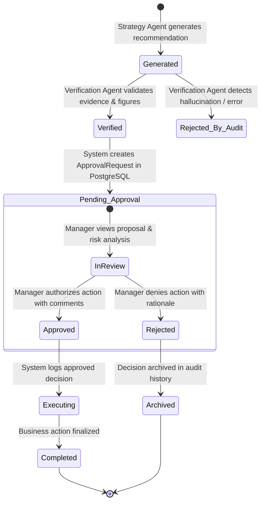

# Human-in-the-Loop (HITL) Approval Workflow Specification

**Document Reference:** HITL-SPEC-2026-V1  
**Project:** AI-Powered Smart Business Operations & Decision Intelligence System  
**Governance Policy:** Consequential Autonomous Business Action Prohibition  

---

## 1. Governance Principles

In an enterprise retail operation, AI agents can identify problems and generate high-value recommendations, but **no autonomous AI agent is permitted to execute consequential financial, procurement, or contractual business actions without explicit human authorization**.

Examples of Consequential Actions Requiring Human Approval:
1. Reallocating marketing budgets between channels or branches.
2. Terminating or renegotiating vendor / supplier procurement contracts.
3. Liquidating slow-moving inventory at severe markdown prices.
4. Altering retail return policies or restocking fee structures.
5. Closing or restructuring unprofitable physical store locations.

---

## 2. End-to-End Approval Workflow State Machine



---

## 3. Human Approval Data Contracts

### 3.1 Approval Request Model
Each recommendation generated by the Strategy Agent and certified by the Verification Agent triggers an immutable `approval_requests` record:
```json
{
  "request_id": 101,
  "recommendation_id": 42,
  "title": "Shift 15% of Digital Promo Budget to Localized Surat & Mumbai Wholesale Campaigns",
  "category": "Marketing",
  "proposed_by": "Strategy Agent",
  "verified_by": "Verification Agent",
  "verification_status": "CERTIFIED_ACCURATE",
  "rationale": "Digital channels experience a 28.7% return rate with high promo abuse. In-store and wholesale orders in Surat and Mumbai show 46.1% repeat rate and 14% higher basket profitability.",
  "expected_impact": "+₹3.2M Net Margin Improvement over 90 days",
  "risk_level": "Medium",
  "supporting_metrics": {
    "current_digital_return_loss": 54540598.98,
    "wholesale_segment_margin": 0.245,
    "current_operating_loss": -3917986.95
  },
  "status": "Pending",
  "created_at": "2026-11-18T14:00:00Z"
}
```

### 3.2 Manager Decision Payload
When an authorized user (`role = 'manager'` or `role = 'admin'`) acts on the proposal:
```json
{
  "decision": "Approved",
  "manager_id": 1,
  "manager_name": "Executive Store Manager",
  "manager_comments": "Approved for 60-day trial in Surat and Mumbai. Review return rates bi-weekly.",
  "decision_timestamp": "2026-11-18T14:15:30Z"
}
```

---

## 4. Frontend & Backend Governance Integration

1. **Frontend UI (`/approvals`)**:
   - Dedicated card and table interface displaying all `Pending`, `Approved`, and `Rejected` requests.
   - Expandable modal displaying supporting evidence, agent reasoning, risk level badge, and verification stamp.
   - Modal action buttons: `Approve Action` (Green) and `Reject Action` (Red) requiring mandatory manager rationale comments.
2. **Backend API (`/api/v1/approvals`)**:
   - `GET /api/v1/approvals`: Filter requests by status (`Pending`, `Approved`, `Rejected`).
   - `POST /api/v1/approvals/{id}/decision`: Accepts decision (`Approved` / `Rejected`) and manager notes.
   - Enforces user authentication via JWT and ensures role is authorized.
3. **Database Persistence**:
   - All state transitions are logged with timestamps, reviewer ID, and comments in PostgreSQL.
