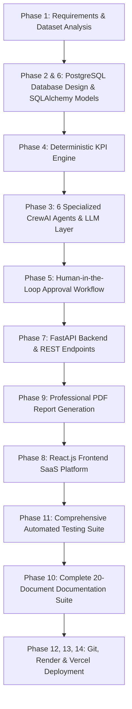

# Project Development Roadmap

**Project:** AI-Powered Smart Business Operations & Decision Intelligence System  
**Timeline:** 14 Execution Phases  
**Standard:** Enterprise Production SaaS  

---

---

## Roadmap Milestones & Deliverables

### Milestone 1: Data Grounding & Database Foundation (Phases 1, 2, 6)
- **Tasks:**
  1. Inspect and validate `03_Retail.xlsx` sheets, primary/foreign keys, date ranges.
  2. Create foundational architecture and analysis documents.
  3. Design normalized PostgreSQL schema with SQLAlchemy ORM models.
  4. Build automated data seeding script to ingest the 6 retail sheets into PostgreSQL.
- **Deliverables:** `docs/` suite, SQLAlchemy models, DB seeding scripts.

### Milestone 2: Deterministic KPI Engine & Multi-Agent Intelligence (Phases 3, 4, 5)
- **Tasks:**
  1. Build Python `KPIService` for deterministic computation of Revenue, COGS, Margins, AOV, MoM trends, and Inventory Turnover.
  2. Implement 6 specialized CrewAI agents with dedicated goals, backstories, tools, and context pipelines:
     - Data Analyst Agent
     - Marketing Agent
     - Finance Agent
     - Operations Agent
     - Strategy Agent
     - Verification Agent
  3. Implement LLM abstraction layer supporting Google Gemini and deterministic fallback.
  4. Implement Human-in-the-Loop recommendation and approval lifecycle.
- **Deliverables:** `kpi_service.py`, `crew_runner.py`, 6 agent definitions, approval service.

### Milestone 3: FastAPI Backend & PDF Engine (Phases 7, 9)
- **Tasks:**
  1. Implement modular FastAPI routers: `/auth`, `/users`, `/business`, `/datasets`, `/analytics`, `/kpis`, `/agents`, `/analysis`, `/chat`, `/reports`, `/approvals`, `/admin`.
  2. Implement JWT bearer authentication and RBAC dependency injection.
  3. Create background task execution manager for long-running CrewAI workflows with live status persistence.
  4. Build ReportLab PDF generator for Consolidated BI Report + 6 individual specialist reports.
- **Deliverables:** Working FastAPI server, Swagger UI documentation (`/docs`), PDF generation engine.

### Milestone 4: Modern React SaaS Frontend (Phase 8)
- **Tasks:**
  1. Initialize React + Vite + Tailwind CSS + Lucide Icons + Recharts.
  2. Build 18 SaaS screens with responsive enterprise navigation:
     - Login & Registration
     - Main Executive Dashboard
     - Business Profile
     - Dataset Upload & Preview
     - Dataset History
     - Multi-Agent AI Analysis Hub
     - Live Agent Monitoring (step-by-step progress & outputs)
     - AI Chat Assistant with verified calculation grounding
     - Reports & Analytics Hub (with instant PDF downloads)
     - Report Details Viewer
     - Recommendation & Approval Management Center
     - Decision Audit History
     - User Management & Admin Dashboard
     - Settings
  3. Connect all frontend components to live FastAPI backend endpoints.
- **Deliverables:** Fully interactive, responsive SaaS frontend web application.

### Milestone 5: Testing, Documentation & Live Deployment (Phases 10, 11, 12, 13, 14)
- **Tasks:**
  1. Execute automated pytest test suite for backend, auth, KPIs, agents, approvals, and report generation.
  2. Complete full 20-document technical documentation suite.
  3. Configure Git repository with clean commits.
  4. Configure Render deployment files (`render.yaml`, `Dockerfile`) and Vercel configuration (`vercel.json`).
  5. Verify live deployment URLs and write project demonstration viva script.
- **Deliverables:** Automated test reports, 20 markdown manuals, GitHub repository, live deployment configuration.
