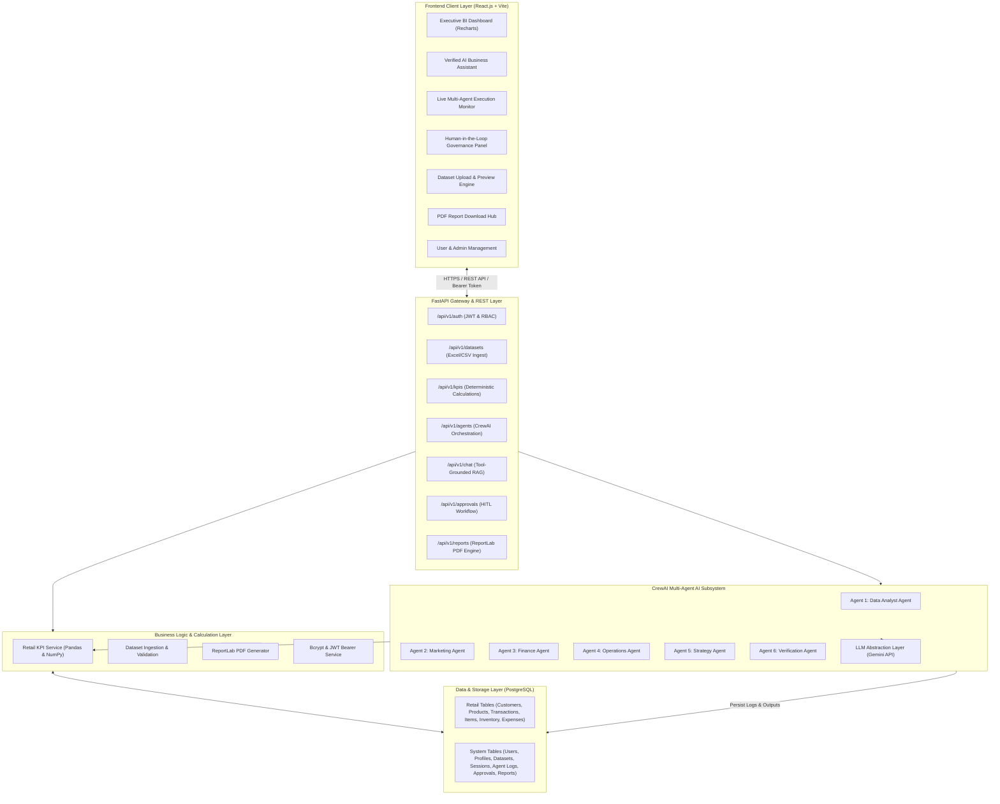

# System Architecture & Technical Design Specification

**Document Reference:** ARCH-RET-2026-V1  
**Project:** AI-Powered Smart Business Operations & Decision Intelligence System  
**Pattern:** Clean Layered Architecture with Autonomous Multi-Agent AI Subsystem  

---

## 1. High-Level Architecture Overview

---

## 2. Architectural Layers

### 2.1 Presentation Layer (React.js)
- **Framework:** React 18 with Vite build tooling.
- **Styling:** Tailwind CSS with responsive typography, dark/light slate enterprise color hierarchy.
- **Data Visualization:** Recharts (responsive area charts, bar charts, donut charts, and trend metrics).
- **State & Context:** React Context API (`AuthContext`) managing JWT session, active company profile, and persistent user preferences.
- **API Client:** Axios instance with request/response interceptors automatically injecting `Authorization: Bearer <token>` and handling token refresh/401 redirects.

### 2.2 API & Gateway Layer (Python FastAPI)
- **Routing:** Independent route modules under `backend/routers/` to ensure zero file bloat and high modularity.
- **Data Serialization:** Pydantic v2 schemas providing strict compile-time and runtime type validation for all incoming and outgoing payloads.
- **Security:** OAuth2 password bearer flow with HMAC-SHA256 JWT tokens. Role-based dependency checkers (`RoleChecker(['admin', 'manager'])`).
- **Background Execution:** FastAPI `BackgroundTasks` orchestrating long-running CrewAI multi-agent runs asynchronously while persisting status so the React frontend can poll or stream real-time progress.
- **OpenAPI / Swagger:** Interactive documentation automatically exposed at `/docs` and `/redoc`.

### 2.3 Business Logic & Calculation Layer
- **`KPIService`**: Centralized, reusable mathematical service using Pandas and NumPy. Dashboard metric endpoints, PDF report generators, and AI agent tools all consume this single source of truth.
- **`IngestionService`**: Handles file validation, reading multi-sheet Excel files with OpenPyXL, validating foreign key links, casting types, and executing atomic database transactions.
- **`PDFReportService`**: Built on ReportLab to generate publication-grade PDF documents with tabular layouts, KPI badges, executive summaries, and agent findings.

### 2.4 Multi-Agent Layer (CrewAI + LLM Provider Abstraction)
- **Framework:** CrewAI orchestrating 6 distinct agents.
- **LLM Abstraction:** A flexible provider wrapper (`LLMProvider`) designed to interface with Google Gemini (via `google-genai` / `crewai` LLM configuration) and capable of deterministic fallback if external network quotas are restricted.
- **Execution Workflow:** Sequential and hierarchical context delegation. Specialized agents analyze specific domains and forward structured outputs into the Strategy Agent. The Verification Agent performs mathematical cross-checking before marking any analysis session `Verified`.

### 2.5 Relational Persistence Layer (PostgreSQL)
- **Database Engine:** PostgreSQL (hosted on Render in production).
- **ORM:** SQLAlchemy 2.0 with connection pooling (`pool_size=10`, `max_overflow=20`), parameterized queries, and foreign key constraints.
- **Migrations:** Alembic ready for database versioning and schema maintenance.
